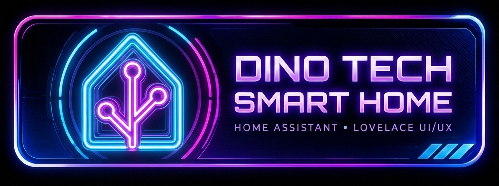
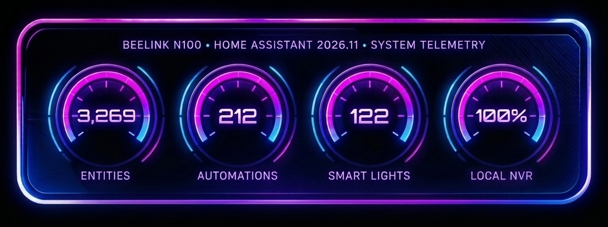

  
    

  <!-- Primary Telemetry & Repo Status Badges (Neon Cyberpunk Theme) -->
  

    
    
    
    
  

  

    
    
    
    
    
  

  <h3 align="center">⚡ Next-Gen Home Assistant Configuration & WebGL Neon Lovelace UI/UX ⚡ Be sure to ⭐ star this repo to stay current on the latest custom cards, themes & AI automations!</h3>

  

    <strong>Designed for Smart Home Architecture & High-Contrast Lovelace UI/UX Inspiration.</strong> 
    Explore a production smart home powered by local WebRTC/Thingino NVR cameras, multi-agent AI vision & voice pipelines, and custom WebGL neon glassmorphism dashboards. All configurations, custom cards, and themes are open-source and free to use.
  

  <!-- Quick-Jump Neon Pill Navigation Bar -->
  

    
    
    
    
    
    
    
  

  <!-- WebGL 4-Gauge Live System Telemetry HUD Banner -->
  
   
  Inspired by the WebGL neon plasma aesthetic of <a href="https://github.com/cerealkiller57540/neon-dual-gauge-card">neon-dual-gauge-card</a> & community documentation by <a href="https://github.com/CCOSTAN/Home-AssistantConfig/blob/master/README.md">CCOSTAN</a>

  

  

  <h2>Currently operating <a href="https://home-assistant.io">Home Assistant</a> version 2026.11.0 
  Running on a <a href="https://amzn.to/3F3oci0">Beelink Mini PC (N100, 16GB RAM)</a></h2>

<h3 id="stats">
  Tracked :bar_chart: Stats On my Setup
  
</h3>

| Entities | Lights | Binary Sensors | Switches | Automations | Scripts | Sensors | Areas | Fans | Media Players |
| :---: | :---: | :---: | :---: | :---: | :---: | :---: | :---: | :---: | :---: |
| 3,269 | 122 | 332 | 213 | 128 | 84 | 1,120 | 29 | 10 | 93 |

<strong>View Automation code and sensors for tracking</strong>

 
<ul>
<li><a href="https://github.com/Dino-Tech/Home-Assistant-Main/blob/master/includes/sensor.yaml#L367-L470">Sensors needed</a></li>
<li><a href="https://github.com/Dino-Tech/Home-Assistant-Main/blob/master/automations.yaml#L171-L188">Automation to update sensors</a></li>
</ul>

<h3 id="devices">
  :movie_camera: Cameras & NVR — Local RTSP/WebRTC + AI Vision
  
</h3>

All 11 security cameras run **100% locally** with no cloud dependencies, paired with a **Google Nest Doorbell** at the porch/side entrance. The Wyze and WUUK cameras are flashed with [Thingino](https://github.com/themactep/thingino-firmware) open-source firmware for native RTSP streaming. Video is aggregated through [go2rtc](https://github.com/AlexxIT/go2rtc) and served to Home Assistant via [WebRTC](https://github.com/AlexxIT/WebRTC), with continuous/event recording handled by the [$15 Thingino NVR](https://github.com/themactep/thingino-firmware/wiki/Integration:-$15-NVR).

| Qty | Camera | Firmware / Integration | Locations |
| :---: | --- | --- | --- |
| 4 | WUUK Y0510 | [Thingino](https://github.com/themactep/thingino-firmware) (Local RTSP) | Garage, Driveway, Backyard, Patio |
| 3 | Wyze Cam v3 | [Thingino](https://github.com/themactep/thingino-firmware) (Local RTSP) | Entryway, Kitchen, Den |
| 2 | Wyze Cam v2 | [Thingino](https://github.com/themactep/thingino-firmware) (Local RTSP) | Office (Rambo Cam), Hallway |
| 2 | Reolink Lumus / Lumus Pro | [Reolink Native](https://www.home-assistant.io/integrations/reolink/) (Local) | Front Door (Porch), Front Yard |
| 1 | [Google Nest Doorbell](https://www.home-assistant.io/integrations/nest/) | Google Nest SDM / WebRTC | Porch / Side Door |

**Streaming, Recording & AI Vision Stack:**
- **[go2rtc](https://github.com/AlexxIT/go2rtc) v1.9.14** — RTSP stream aggregation + low-latency WebRTC relay
- **[WebRTC Camera](https://github.com/AlexxIT/WebRTC)** — Instant browser/kiosk streams in Lovelace & wall-mounted Nest displays
- **[Reolink Integration](https://www.home-assistant.io/integrations/reolink/)** — Native local HA integration (91 entities + AI person/vehicle/pet detection)
- **[Google Nest Integration](https://www.home-assistant.io/integrations/nest/)** — Nest Doorbell live stream, chime events, and unified front-door person detection
- **[$15 Thingino NVR](https://github.com/themactep/thingino-firmware/wiki/Integration:-$15-NVR)** — Local network video recording with automated clip & snapshot retention cleanup
- **Gemini 3.8 Flash AI Video Triage (`script.analyze_motion_clip`)** — Records 10-second MP4 motion clips (`script.record_motion_clip`) and runs 2-stage multimodal AI scene analysis (including property-boundary Street vs. Driveway/Yard triage to eliminate false-positive street pedestrian alerts) before broadcasting TTS summaries or mobile snapshots
- **Fire TV Picture-in-Picture Overlays (`nfandroidtv`)** — Live camera snapshots/alerts pushed directly to TV screens on motion
- All local cameras isolated on a dedicated VLAN

<strong>Related Automations & Scripts</strong>

 
<ul>
<li><strong>Camera Alert Automations:</strong> Driveway Motion, Front Porch Motion, Front Yard Motion (2-Stage AI Street/Property Triage), Garage Motion, Patio Motion</li>
<li><strong>Doorbell & Display Automations:</strong> <code>[Notify] Front Door Person Detected (Unified)</code>, <code>Side Door Camera live view for wall mounted Nest</code></li>
<li><strong>AI Clip & Video Processing Scripts:</strong> <code>Record Motion Clip</code>, <code>Analyze Motion Clip</code>, <code>Driveway Video Processing</code>, <code>Porch Video Processing</code>, <code>Front Yard Video Processing</code>, <code>Garage Video Processing</code>, <code>Patio Video Processing</code></li>
<li><strong>TV Overlay & Maintenance:</strong> <code>Fire TV Overlay (Driveway / Porch / Garage / Patio)</code>, <code>[System] Purge Old Motion Clips</code>, <code>Maintenance - Cleanup Old Snapshots</code>, <code>reboot cameras</code></li>
</ul>

<h3 id="nest">
  :thermometer: Climate, :fire_engine: Smoke/CO/Leak Safety & :satellite: Local Hub Stack
  
</h3>

SmartThings has long been retired in favor of **direct local control** across Z-Wave 800 Long Range, Zigbee (ZHA), ESPHome, Shelly Gen2/Gen3, and YoLink LoRa—paired with Google Nest for central HVAC and multi-sensor smoke/CO protection.

| Category | Hardware / Devices | Integration | Locations & Role |
| --- | --- | --- | --- |
| **Climate & HVAC** | [Google Nest Thermostat](https://amzn.to/2TVTw7v) Mini-Split AC + **SMLIGHT SLWF-01Pro** | `nest` `esphome` | **Den** (Central HVAC) & **Kitchen** (Mini-Split AC synced to Den cooling + HVAC condenser mister) |
| **Smoke, CO & Heat** | 3 × [Google Nest Protect](https://amzn.to/2wKsJmm) 2 × First Alert **SMCO410** (Z-Wave) 1 × [First Alert **ZCOMBO**](https://amzn.to/2VZ9JLv) (Z-Wave) 1 × **Shelly Smoke** | `nest_protect` `zwave_js` `zwave_js` `shelly` | **Kitchen, Hallway, Garage** (Smoke/CO/Heat/Pathlight) **Bedroom, Office** (Z-Wave 800LR Smoke & CO) **Laundry Room** (Z-Wave Smoke & CO) **Guest Room** (Wi-Fi Smoke Detector) |
| **Water Leak & Valve Protection** | **YoLink Motorized Main Water Valve** + 5 × YoLink Leak Sensors | `yolink` | **Main Water Shutoff** + **Attic HVAC, Water Heater, Washer, Ensuite Sink, Bathroom** |
| **Local Zigbee & Z-Wave Coordinators** | **SMLIGHT SLZB-06** (Network Zigbee) **Zooz ZST39 LR** (800-Series Z-Wave LR) | `zha` `zwave_js` | Coordinates Zigbee presence/motion/door sensors & smart plugs (`SONOFF`, `Third Reality`, `Aqara`) and Z-Wave 800LR devices (`First Alert`, `Shelly Wave`, `Minoston`) |
| **Shelly & ESPHome Local Control** | 20+ **Shelly Plus Wall Dimmers** & **1/1PM Mini Gen3** Relays, **Shelly H&T**, **BLU Gateways**, **Broadlink RM4 Pro** | `shelly` `esphome` `broadlink` | Whole-home lighting dimmers, exhaust fan humidity managers, garage door control, RF ceiling fans, and local **ESPHome** nodes |

**Key Climate, Safety & Presence Workflows:**
- **Dual-Zone Climate Sync & Custom WebGL UI:** Controlled via custom WebGL `neon-climate-card` popups with live fluid shaders. When the Den Nest Thermostat enters cooling mode, `[Climate] Kitchen Mini Split - Follow Den Cooling` automatically coordinates the Kitchen Mini-Split, while `[Control] HVAC Mister` and `[Timer] HVAC Fan Timer` optimize condenser efficiency and air circulation.
- **Master Presence & Occupancy Engine:** Home/Away states (`Brain: House Mode Manager`, `[Presence] Master Presence Control`, `script.nest_set_home`, `script.nest_set_away`) combine mobile geofencing, Find My Device (`[FMD]`) high-frequency arrival/departure polling, and room-level **mmWave + PIR occupancy sensors** (`SONOFF SNZB-06P`, `Athom Presence Sensor`, `AtomS3 Motion`).
- **Multi-Layer Fire, CO & Water Leak Defense:** All 7 smoke/CO detectors (Nest Protect, First Alert Z-Wave, and Shelly) feed unified emergency alert pipelines (`[Notify] NEST Fire, Smoke, CO, & Heat Detected II`), while YoLink LoRa leak sensors monitor the Attic HVAC pan, Water Heater, Washer, and bathrooms with instant critical alerts and automated main water valve control.

<strong>Related Automations & Scripts</strong>

 
<ul>
<li><strong>Climate & Ventilation Automations:</strong> <code>[Climate] Kitchen Mini Split - Follow Den Cooling</code>, <code>[Control] HVAC Mister</code>, <code>[Timer] HVAC Fan Timer</code>, <code>[Auto] Bathroom Vent Manager (Combined)</code>, <code>[Auto] Ensuite Vent Manager (Combined)</code>, <code>[Auto] Fan Control (Away Mode)</code>, <code>[SWITCH] Den / Office / Guest Fan Cycle (Dynamic with State)</code></li>
<li><strong>Fire, Smoke, CO & Leak Safety Automations:</strong> <code>[Notify] NEST Fire, Smoke, CO, & Heat Detected II</code>, <code>[Notify] Fire, Smoke, CO, & Heat All Clear None Detected</code>, <code>[Notify] Critical Water Leak Alert</code>, <code>[Notify] HVAC Water Leak</code>, <code>[Notify] Secondary Water Leak Alert & All Clear</code></li>
<li><strong>Presence & House Mode Automations:</strong> <code>Brain: House Mode Manager</code>, <code>[Presence] Master Presence Control</code>, <code>[Presence] First Person Arrives - Welcome actions</code>, <code>[Presence] Last Person Leaves - Away actions</code>, <code>[Presence] mmWave Occupancy Light Control</code>, <code>[FMD] Turn ON High Frequency Mode on Departure</code></li>
<li><strong>Climate & Presence Scripts:</strong> <code>Set Nest Home</code>, <code>Set Nest Away</code>, <code>People Home</code>, <code>People Away</code>, <code>Wake Up (morning)</code>, <code>Good Night</code>, <code>Den Fan Speed 1–6 / Power / Reverse</code></li>
</ul>

<h3 id="networking">
  :globe_with_meridians: UniFi Networking, NextDNS & :battery: APC UPS Fleet
  
</h3>

The home network is built around an enterprise **Ubiquiti UniFi** core with dedicated VLAN isolation for IoT and local NVR cameras, paired with **NextDNS** security filtering and a **4-unit APC UPS** battery backup fleet.

| Category | Hardware | Qty | Role & Telemetry |
| --- | --- | :---: | --- |
| **Core Router / Gateway** | **Ubiquiti UniFi Dream Machine Pro (UDM Pro)** | 1 | Core routing, IDS/IPS, VLAN segmentation, and live HA WAN/CPU/PHY telemetry (`unifi` / `unifiprotect`) |
| **Wi-Fi 6 / Wi-Fi 7 APs** | **Ubiquiti UniFi U6-LR** (Long-Range Wi-Fi 6) **Ubiquiti UniFi U7 Lite** (Wi-Fi 7) | 2 1 | High-density whole-home & outdoor multi-SSID mesh coverage across 125+ connected clients |
| **Core & PoE Switching** | **Netgear 16-Port Unmanaged Gigabit Switch** **Netgear 8-Port PoE Switch** | 1 1 | Wired Gigabit backhaul + PoE distribution for cameras, access points, and coordinators |
| **DNS Security** | **NextDNS (`nextdns`)** | Cloud/DoH | 5.5M+ queries tracked in HA with real-time cryptojacking, DGA, homograph, and typosquatting protection |
| **UPS Battery Backups** | **APC Back-UPS XS 1500M** (1500VA) **APC Back-UPS 850** (850VA) **APC Back-UPS Connect** | 1 2 1 | Rack/server & network battery backup monitored via **NUT (Network UPS Tools)** (`nut`) with automated outage alerts |

<strong>Related Automations & Network Watchdogs</strong>

 
<ul>
<li><strong>Power & UPS Monitoring:</strong> <code>UPS Status Notifications</code> (instant alerts on utility power loss, battery runtime, and restoration via NUT)</li>
<li><strong>System & Integration Health:</strong> <code>Integration Watchdog</code>, <code>Watchdog: Stale Sensor Check</code>, <code>Unavailable Entities 2-Hour Check</code>, <code>Watchdog: Automatic Backup Size Alert</code>, <code>Report state on start-up</code></li>
</ul>

<h3 id="displays">
  :tv: Kiosks, Smart Displays, TVs & :microphone: AI Voice / Audio Ecosystem
  
</h3>

Whole-home control, media, and voice are unified across wall-mounted **Fully Kiosk** tablets, **Home Assistant Voice PE** hardware satellites, **Music Assistant** multi-room audio, and Android/Google TV displays.

| Category | Devices | Integration | Locations & Capabilities |
| --- | --- | --- | --- |
| **Wall Kiosks & Tablets** | 2 × **Digiland 10.1" (`DL1036`)** Kiosks 1 × **Google Pixel Tablet (`Pixel Fully`)** | `fully_kiosk` `browser_mod` | **Den (Main Kiosk)**, **Master Ensuite**, & **Pixel Tablet** — auto-changing video wallpapers, motion wake/sleep, and popup cards |
| **AI Voice Satellites** | 2 × **Home Assistant Voice Preview Edition (Voice PE)** | `esphome` `assist_satellite` | **Office** & **Den** — local ESP32-S3 voice hardware powered by **OpenAI `gpt-5.4-mini` / `gpt-6-luna`** (`SmarterVoice`) & **Google `gemini-3.8-flash`** (`JARVIS`) |
| **Smart Displays** | 3 × **Google Nest Hub** 1 × **Lenovo Smart Clock** | `cast` `music_assistant` | **Office**, **Entryway**, **Kitchen Cabinet**, & **Guest Room** — camera live-view casting, TTS announcements, and media dashboards |
| **Multi-Room Audio** | 3 × **Google Nest Audio** 3 × **Google Home** 4 × **Google Home Mini** 1 × **Insignia Voice Speaker** 1 × **Esparagus Audio Brick** (ESP32) | `music_assistant` `cast` `esphome` | **12+ Speakers & Cast Groups** across Den, Living Room, Foyer, Kitchen, Bedroom, Bathroom, Ensuite, Garage (Stereo Pair), and Patio |
| **TVs & Ambient Sync** | **Samsung 65" 4K (`Den TV`)** + **Google TV Streamer** **TCL (`Ensuite TV`)** + **onn. 4K Plus** **Guest Room TV** (**onn. 4K Box**) & **Bedroom TV** (**Chromecast**) **GLEDOPTO Ethernet WLED** + **SceneGlow** | `samsungtv_smart` `androidtv_remote` `nfandroidtv` `wled` / `sceneglow` | Real-time **SceneGlow + WLED** ambient TV bias lighting in the Den + live **Picture-in-Picture camera motion overlays** on TVs via `nfandroidtv` |

<strong>Related Automations & Voice/Media Scripts</strong>

 
<ul>
<li><strong>Kiosk & Dynamic UI Automations:</strong> <code>[Tablet] Theme Match for Video Wallpaper V18</code>, <code>[Tablet] Background and Theme Manager</code>, <code>[Tablet] Toggle tablet icons color</code>, <code>[Motion] Nightlights and Kiosk</code>, <code>Reboot Kiosk</code></li>
<li><strong>AI Voice & Music Assistant Scripts:</strong> <code>LLM Script for Music Assistant voice requests</code>, <code>DJ Announcer (Music Assistant)</code>, <code>Assist: Search Google</code>, <code>Voice Assistant - Weather Forecasts</code>, <code>Ask a Yes/No question (Office / Kitchen Lights)</code>, <code>Ring Pixel Pro</code></li>
<li><strong>TV, Audio & TTS Workflows:</strong> <code>TV Ambient Lights Sync with TV</code>, <code>Experiences: Esparagus EQ Preset Sync</code>, <code>Reset Speaker Volumes</code>, <code>Audible Clocks (Grandfather & Cuckoo)</code>, <code>NWS - Weather Alerts & TTS Announcements</code>, <code>Door Announcements (TTS)</code>, <code>tts daily / bedtime msg (Darren & Donna)</code></li>
</ul>

<h3 id="alarm">
  :rotating_light: Konnected ESPHome Alarm, Alarmo & :shield: Security Sensors
  
</h3>

Home security combines **hardwired Konnected alarm panels** (flashed with native **ESPHome** firmware) and **[Alarmo](https://github.com/nielsfaber/alarmo)** orchestration with **104 motion/mmWave occupancy entities**, **22 door/window/garage sensors**, and **YoLink LoRa smart locks**.

| Category | Hardware | Protocol / Integration | Coverage & Details |
| --- | --- | --- | --- |
| **Hardwired Alarm Panels** | **Konnected Alarm Panel Pro** (12-Zone PoE/Ethernet) **Konnected Alarm Panel** (6-Zone Wi-Fi) | `esphome` `alarmo` | 18 hardwired zones covering **Garage, Living Room, Master, Guest, Kitchen Bay, & Office/WC Windows**, **Back & Garage Entry Doors**, wired **Ceiling PIR Motion** (Den, Ensuite, Laundry), warning piezos, & **Main Siren** |
| **Smart Locks & Garage** | 2 × **YoLink Smart Locks (`LockV2`)** + **Back Door Lock** **Shelly Plus 1** Garage Controller | `yolink` `shelly` | **Front Door**, **Side Door**, **Back Door**, & **Garage Door** with automated away-alerting and actionable mobile close notifications |
| **mmWave Human Presence** | **SONOFF SNZB-06P**, **Athom Presence Sensor**, **AtomS3 Motion**, **Tuya TS0225** | `zha` `esphome` | Stationary human presence detection in **Office**, **Kitchen**, **Den**, and **Ensuite** |
| **Zigbee, Z-Wave & LoRa Sensors** | **YoLink LoRa** Outdoor Motion & Door Sensors **Third Reality** (`3RSNL02043Z` Nightlight/Motion, `3RMS16BZ`, `3RDS17BZ`) **SONOFF / Aqara / eWeLink** Motion & Contact **Shelly Motion 2** & **Philio Z-Wave PST02A** | `yolink` `zha` `shelly` `zwave_js` | Whole-home indoor/outdoor perimeter & room motion (**Porch, Driveway/Side, Patio, Foyer, Bedroom, Guest, Garage, Hallway**) + **LoRa Mailbox Sensor** |

<strong>Related Security & Lighting Automations</strong>

 
<ul>
<li><strong>Alarmo Orchestration:</strong> <code>[Alarmo] Master Control</code>, <code>[Alarmo] Auto Night Arm</code>, <code>[Alarmo] Someone's awake run Morning script & Disarm alarm</code>, <code>alarm_arm / alarm_arm_home / alarm_disarm / away_mode_armed</code></li>
<li><strong>Garage, Locks & Perimeter Alerts:</strong> <code>[Alert] Send Garage Door Notification</code>, <code>[Alert] Handle Garage Door Acknowledge</code>, <code>Close the garage when notification action is tapped</code>, <code>Notify us when the garage door opens and no one home</code>, <code>Mailbox Opened Notification</code></li>
<li><strong>Security Deterrence & Entry Lighting:</strong> <code>Security: Random Lighting Simulation</code>, <code>Security: Turn Off Simulation Lights on Arrival</code>, <code>Turn ON front yard / backyard lights when door opened</code>, <code>Garage: Lights ON when Door Opens / OFF after Door Closes</code></li>
</ul>

<h1>Screenshots</h1>

<h3 id="mobile">
  Mobile Screens (Pixel 8 Pro / Pixel 10a)
  
</h3>

<strong>See Android Themes</strong>

 
<a href="https://github.com/Dino-Tech/Home-Assistant-Main">Android Themes Link</a>

  
  

#### Themes (Click-to-change)
These 12 themes are fully integrated with all popups and custom cards.

<h3 id="tablet">
  Tablet Screens (Fully Kiosk Browser)
  
</h3>

Main panel has auto-changing background images, sleep/wake via motion, and voice activation. The result is like having 30 different views accessed via *one* main screen.

<a href="https://www.affordableautomating.com/affiliate-disclosure">Affiliate Disclosure</a>

