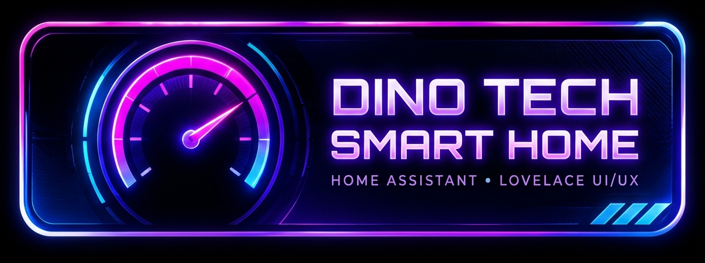
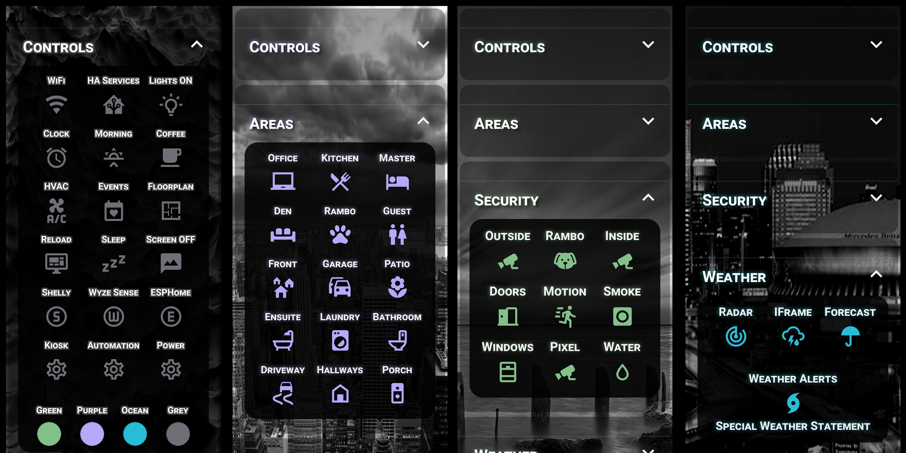
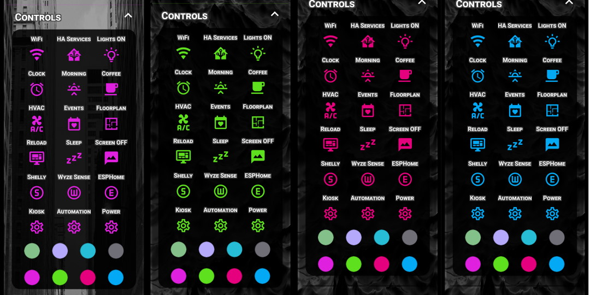
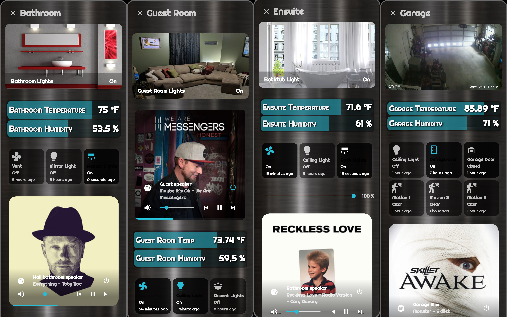
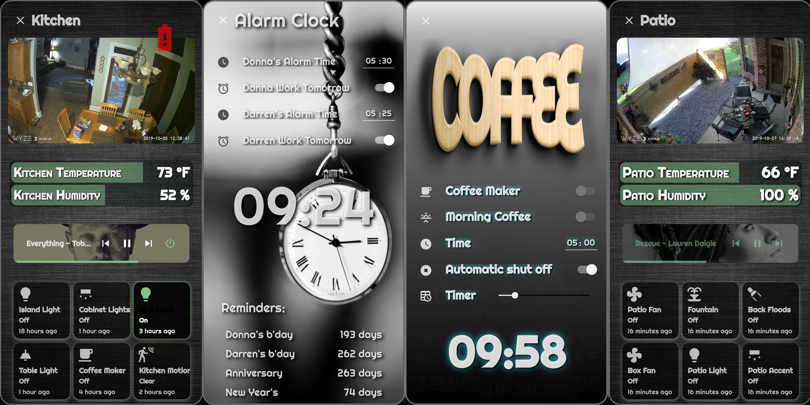
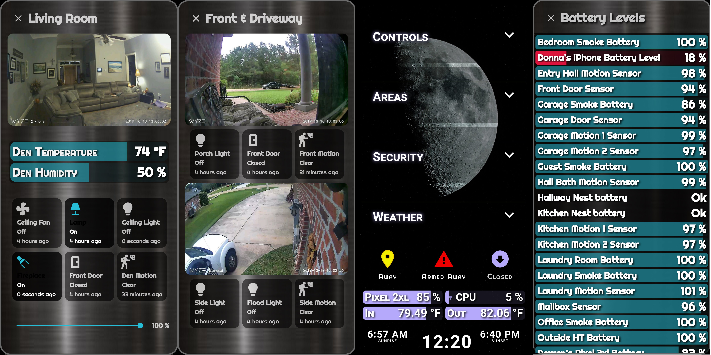
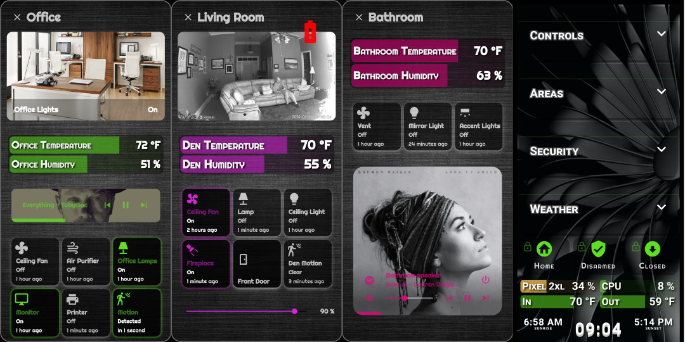
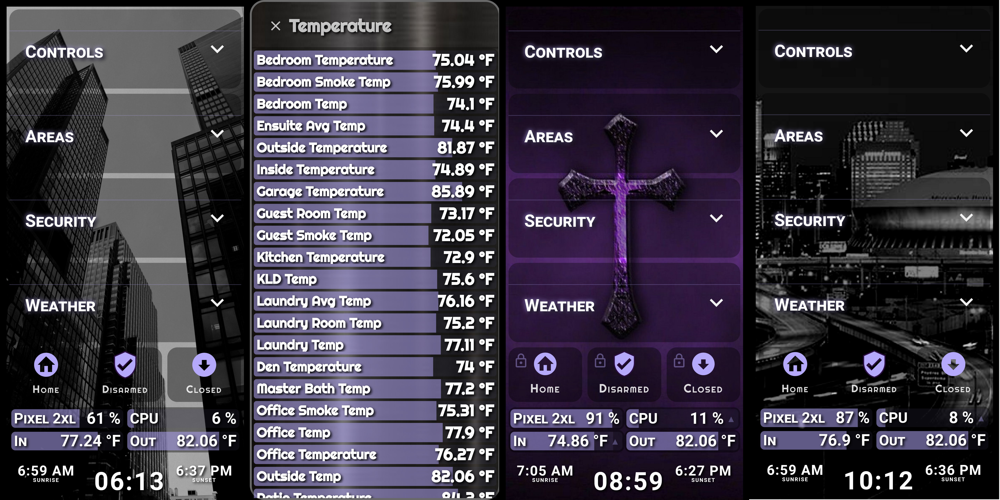
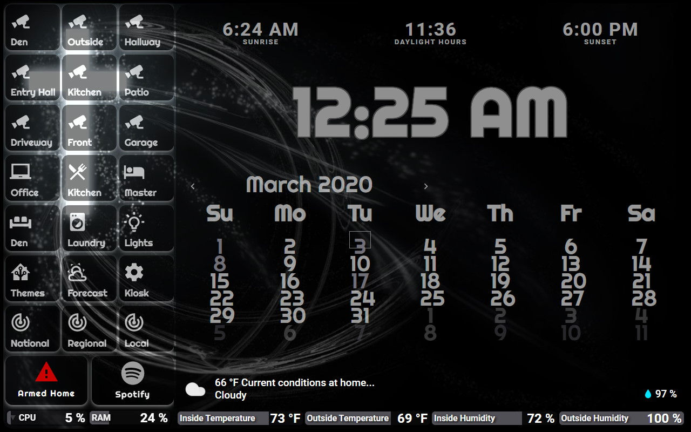

  
    

  <!-- Primary Telemetry & Repo Status Badges (Neon Cyberpunk Theme) -->
  

    
    
    
    
  

  

    
    
    
    
    
  

  <h3 align="center">⚡ Next-Gen Home Assistant Configuration & WebGL Neon Lovelace UI/UX ⚡ Be sure to ⭐ star this repo to stay current on the latest custom cards, themes & AI automations!</h3>

  

    <strong>Designed for Smart Home Architecture & High-Contrast Lovelace UI/UX Inspiration.</strong> 
    Explore a production smart home powered by local WebRTC/Thingino NVR cameras, multi-agent AI vision & voice pipelines, and custom WebGL neon glassmorphism dashboards. All configurations, custom cards, and themes are open-source and free to use.
  

  <!-- Quick-Jump Neon Pill Navigation Bar -->
  

    
    
    
    
    
    
    
  

  <!-- WebGL 4-Gauge Live System Telemetry HUD Banner -->
  
   
  Inspired by the WebGL neon plasma aesthetic of <a href="https://github.com/cerealkiller57540/neon-dual-gauge-card">neon-dual-gauge-card</a> & community documentation by <a href="https://github.com/CCOSTAN/Home-AssistantConfig/blob/master/README.md">CCOSTAN</a>

  

  

  <h2>Currently operating <a href="https://home-assistant.io">Home Assistant</a> version 2026.11.0 
  Running on a <a href="https://amzn.to/3F3oci0">Beelink Mini PC (N100, 16GB RAM)</a></h2>

<h3 id="stats">
  Tracked :bar_chart: Stats On my Setup
  
</h3>

| Entities | Lights | Binary Sensors | Switches | Automations | Scripts | Sensors | Areas | Fans | Media Players |
| :---: | :---: | :---: | :---: | :---: | :---: | :---: | :---: | :---: | :---: |
| 3,269 | 122 | 332 | 213 | 128 | 84 | 1,120 | 29 | 10 | 93 |

<strong>View Automation code and sensors for tracking</strong>

 
<ul>
<li><a href="https://github.com/Dino-Tech/Home-Assistant-Main/blob/master/includes/sensor.yaml#L367-L470">Sensors needed</a></li>
<li><a href="https://github.com/Dino-Tech/Home-Assistant-Main/blob/master/automations.yaml#L171-L188">Automation to update sensors</a></li>
</ul>

<h3 id="devices">
  :movie_camera: Cameras & NVR — 100% Local
  
</h3>

All cameras run **100% locally** with no cloud dependencies. The Wyze and WUUK cameras are flashed with [Thingino](https://github.com/themactep/thingino-firmware) open-source firmware for native RTSP streaming. Video is aggregated through [go2rtc](https://github.com/AlexxIT/go2rtc) and served to Home Assistant via [WebRTC](https://github.com/AlexxIT/WebRTC). Recording is handled by the [$15 Thingino NVR](https://github.com/themactep/thingino-firmware/wiki/Integration:-$15-NVR).

| Qty | Camera | Firmware | Locations |
| :---: | --- | --- | --- |
| 4 | WUUK Y0510 | [Thingino](https://github.com/themactep/thingino-firmware) | Garage, Driveway, Backyard, Patio |
| 3 | Wyze Cam v3 | [Thingino](https://github.com/themactep/thingino-firmware) | Entryway, Kitchen, Den |
| 2 | Wyze Cam v2 | [Thingino](https://github.com/themactep/thingino-firmware) | Office, Hallway |
| 2 | Reolink Lumus / Lumus Pro | Reolink native | Front Door (Porch), Front Yard |

<!-- TODO: Add Amazon product links after research -->

**Streaming & Recording Stack:**
- **[go2rtc](https://github.com/AlexxIT/go2rtc) v1.9.14** — RTSP stream aggregation + WebRTC relay
- **[WebRTC Camera](https://github.com/AlexxIT/WebRTC)** — Low-latency browser streams in Lovelace
- **[Reolink Integration](https://www.home-assistant.io/integrations/reolink/)** — Native HA integration (91 entities)
- **[$15 Thingino NVR](https://github.com/themactep/thingino-firmware/wiki/Integration:-$15-NVR)** — Local network video recording
- All cameras isolated on a dedicated VLAN

<strong>Related Automations & Scripts</strong>

 
<ul>
<li>Camera Alert: Driveway Motion</li>
<li>Camera Alert: Front Porch Motion</li>
<li>Camera Alert: Front Yard Motion</li>
<li>Camera Alert: Garage Motion</li>
<li>Camera Alert: Patio Motion</li>
<li>Front Door Person Detected (Unified)</li>
<li>Driveway Video Processing</li>
</ul>

<h3 id="nest">
  Nest :tophat:, First Alert, and SmartThings
  
</h3>

| [Nest Protects](https://amzn.to/2wKsJmm) | [Nest Thermostats](https://amzn.to/2TVTw7v) | [First Alert ZCOMBO](https://amzn.to/2VZ9JLv) | [SmartThings Hub](https://amzn.to/3375O0E) |
| :---: | :---: | :---: | :---: |
|  |  |  |  |

The Nest thermostats and Protects don't require many automations. The sensors are tracked and the **'away'** and **'home'** modes are set with scripts via Home Assistant's [Person](https://www.home-assistant.io/components/person/) integration for occupancy verification.

<h3 id="networking">
  Networking :globe_with_meridians: and Battery :battery: Backups
  
</h3>

| [Google WiFi](https://amzn.to/2PlSVKI) | [Netgear 16-Port](https://amzn.to/3aGQH0E) | [600VA UPS](https://amzn.to/335JG7b) | [425VA UPS](https://amzn.to/2Q4dHit) |
| :---: | :---: | :---: | :---: |
|  |  |  |  |

*Google WiFi mesh points maintain 126 WiFi clients. Average speed: 434 Mbps.*

<h3 id="displays">
  Displays :tv: and Google Assistant :speaker: Devices
  
</h3>

| [MatrixPad Z4](https://amzn.to/39iRdBN) | [Insignia 10.1"](https://amzn.to/2W2CuHs) | [Google Hub](https://amzn.to/2ut1b4r) | [Google Home](https://amzn.to/2Tfozuj) |
| :---: | :---: | :---: | :---: |
|  |  |  |  |

A total of 14 Google Assisted speakers do a nice job of filling the house with sound. Audio is usually played via [Spotcast](https://github.com/fondberg/spotcast) component and controlled with a fullscreen popup of [Mini-media-player](https://github.com/kalkih/mini-media-player).

<h3 id="alarm">
  Konnected :cop: Alarm & :busts_in_silhouette: Sensors
  
</h3>

| [Konnected Alarm](https://amzn.to/3c6k12c) | [Sonoff RF Bridge](https://amzn.to/2VkO68o) | [Sonoff Motion](https://amzn.to/37XHAXN) | [PIR Motion](https://amzn.to/3c4SBd1) |
| :---: | :---: | :---: | :---: |
|  |  |  |  |

Our home is protected by an 18 zone Konnected alarm system and HA's [Manual MQTT Alarm](https://www.home-assistant.io/integrations/manual_mqtt/). Using 24 motion sensors, 5 door sensors, and a glass break detector.

<h1>Screenshots</h1>

<h3 id="mobile">
  Mobile Screens (Pixel 2 XL)
  
</h3>

<strong>See Android Themes</strong>

 
<a href="https://github.com/Dino-Tech/Home-Assistant-Main">Android Themes Link</a>

  
  

#### Themes (Click-to-change)
These 12 themes are fully integrated with all popups and custom cards.

<h3 id="tablet">
  Tablet Screens (Fully Kiosk Browser)
  
</h3>

Main panel has auto-changing background images, sleep/wake via motion, and voice activation. The result is like having 30 different views accessed via *one* main screen.

<a href="https://www.affordableautomating.com/affiliate-disclosure">Affiliate Disclosure</a>

